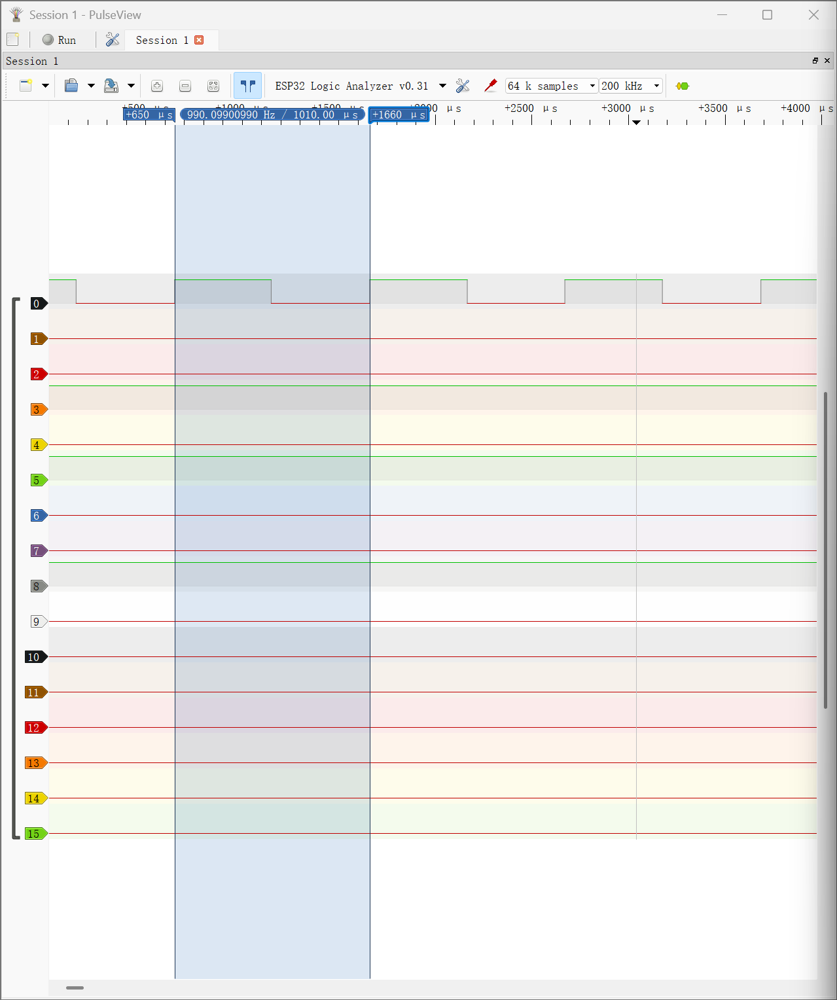

# Module 2

> **Example module** from the IoT introduction class. Adjust the headings and tasks to match your actual course content.

We are going to show here notes for Task 1, 2, 3, 4, and 5 to prove

## Learning Goals

> Copy the module's learning goals from the course workbook. Keep the `LG1`, `LG2`, … IDs and a one-word keyword; under each goal, link to the task that proves it.

### LG1 — `<keyword>`

<copy the goal here>

**Evidence:** [Task 1](#task-1)

### LG2 — `<keyword>`

<copy the goal here>

**Evidence:** [Task 2](#task-2)

### LG3 — `<keyword>`

<copy the goal here>

**Evidence:** [Task 3](#task-3)

## Task 1 — `<short title>`

**Proves:** [LG1](#lg1)

This task was executed by myself.

## Task 2 — Bus Systems Survey (SPI)

**Proves:** [LG2](#lg2)

In this task, I researched the SPI
(Serial Peripheral Interface) bus.
I studied its history, wiring,
communication principles, advantages,
applications, and possible problems.

**Portfolio evidence:**
[SPI Bus Profile](./bus-spi.md)

## Task 3 — `<short title>`

**Proves:** [LG3](#lg3)

 
## Task 9 — Build and Test an ESP32 Logic Analyzer

**Proves:** Practical application of digital signal acquisition and measurement.

In this task, I built a digital logic analyzer using an ESP32 and the open-source ESP32_LogicAnalyzer project by lmcapacho.

I installed the firmware using Arduino IDE and connected the ESP32 to PulseView via the SUMP protocol.

To test the logic analyzer, I used a second development board (ESP8266 D1 mini) to generate a square-wave signal of approximately 1 kHz.

**Hardware connections:**
- ESP8266 D5 (GPIO14) → ESP32 GPIO21 (CH0)
- ESP8266 GND → ESP32 GND
- ESP32 GPIO22 (CLK_OUT) → GPIO23 (CLK_IN)

**Capture settings:**
- Sampling rate: 200 kHz
- Sample count: 64 k samples
- Measured period: 1010 μs
- Measured frequency: 990.10 Hz

The logic analyzer successfully captured the square-wave signal. The measured frequency was close to the expected value of 1 kHz, with a deviation of approximately 0.99%.

**Portfolio evidence:**
- [Task 9 — Detailed Test Report](./scope-decision.md)
- [ESP32 Logic Analyzer — Source Code](https://github.com/lmcapacho/ESP32_LogicAnalyzer)

**Measurement screenshot:**

## Reflection 2

[Reflection 2](../Reflections/ref02.md)

If the module is longer than 1 week, you might have several reflections within it. If not, delete this and the following.

## Reflection 3
[Reflection 3](../Reflections/ref03.md)
