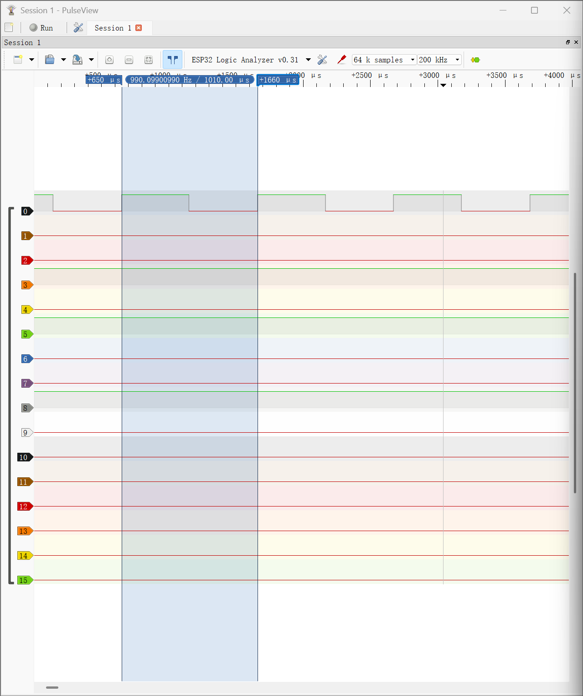

# Task 9 — Build and Choose Our Scope

## 1. Objective

The goal of this task was to build and evaluate an open-source measurement tool for digital signals and communication buses.

I selected the **ESP32 Logic Analyzer by lmcapacho**, which uses the SUMP protocol and can be connected to PulseView.

## 2. Hardware and Software

**Hardware:**
- ESP32 Dev Module — logic analyzer
- ESP8266 D1 mini — square-wave signal generator
- USB cables and jumper wires
- Breadboard

**Software:**
- Arduino IDE 2.3.10
- ESP32_LogicAnalyzer by lmcapacho
- PulseView

**Source:** [lmcapacho/ESP32_LogicAnalyzer](https://github.com/lmcapacho/ESP32_LogicAnalyzer)

## 3. Installation and Setup

1. Downloaded the ESP32_LogicAnalyzer project from GitHub.
2. Opened the project in Arduino IDE.
3. Selected ESP32 Dev Module and installed the required CP210x USB-to-UART driver.
4. Compiled and uploaded the firmware to the ESP32.
5. Installed PulseView and selected the Openbench Logic Sniffer & SUMP compatible driver.
6. Connected the ESP32 through its serial port.
7. Verified that PulseView recognized the device as **ESP32 Logic Analyzer v0.31**.

## 4. Wiring

For the square-wave test, an ESP8266 D1 mini was programmed to generate a digital signal of approximately 1 kHz.

| Connection | Purpose |
|---|---|
| ESP8266 D5 (GPIO14) → ESP32 GPIO21 (CH0) | Digital test signal |
| ESP8266 GND → ESP32 GND | Common ground |
| ESP32 GPIO22 (CLK_OUT) → GPIO23 (CLK_IN) | Sampling clock loopback |

Both boards were powered via USB.

## 5. Measurement

**PulseView configuration:**

| Parameter | Value |
|---|---|
| Sampling rate | 200 kHz |
| Sample count | 64 k samples |
| Input channel | CH0 (GPIO21) |
| Expected signal frequency | Approximately 1 kHz |

**Measured results:**

| Parameter | Result |
|---|---|
| Period | 1010 µs |
| Frequency | 990.10 Hz |
| Deviation from 1000 Hz | Approximately 0.99% |

The measured frequency was close to the expected frequency. The difference may be caused by software execution overhead and timing limitations.

### Measurement Screenshot

## 6. Evaluation

The ESP32 Logic Analyzer successfully captured a digital square-wave signal generated by the ESP8266.

**Advantages:**
- Open-source solution
- Uses existing ESP32 hardware
- Compatible with PulseView
- Supports multiple digital channels
- Enables digital waveform visualization and timing measurements

**Limitations:**
- Designed for digital signals, not precise analog voltage measurements
- Input voltage must remain within the supported 3.3 V logic range
- Measurement quality depends on the sampling rate and signal frequency
- Additional testing is required to verify I²C protocol decoding

## 7. Current Decision and Further Work

Based on the square-wave test, the lmcapacho ESP32 Logic Analyzer is a promising candidate for digital signal analysis (Role A).

The square-wave capture and frequency measurement were successful.

However, the final class-wide selection of measurement tools has not yet been documented. A browser-based analog oscilloscope (Role B) and I²C protocol decoding should also be evaluated.

**Conclusion:** The digital square-wave test was successful, but the complete instrument evaluation is still in progress.
